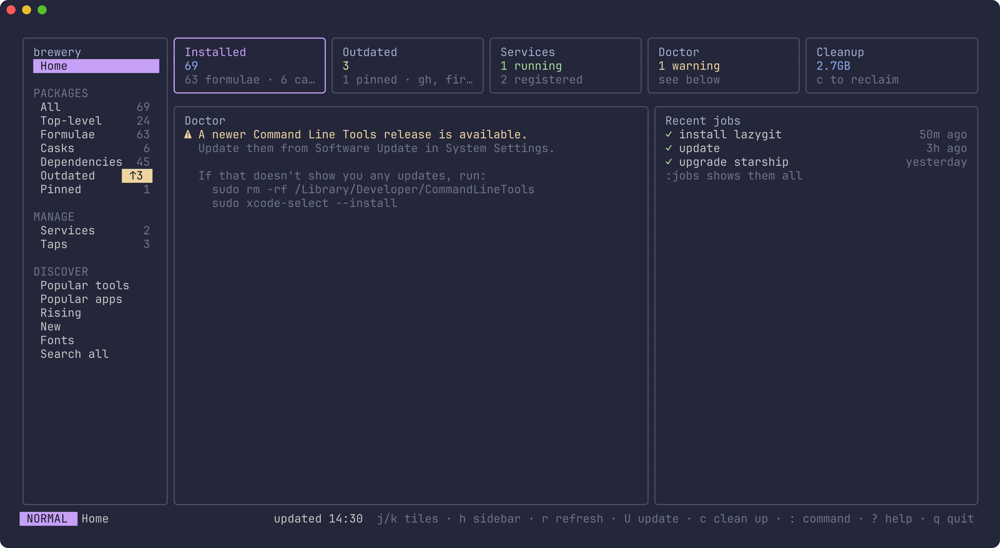
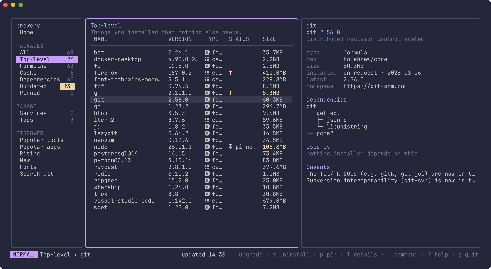
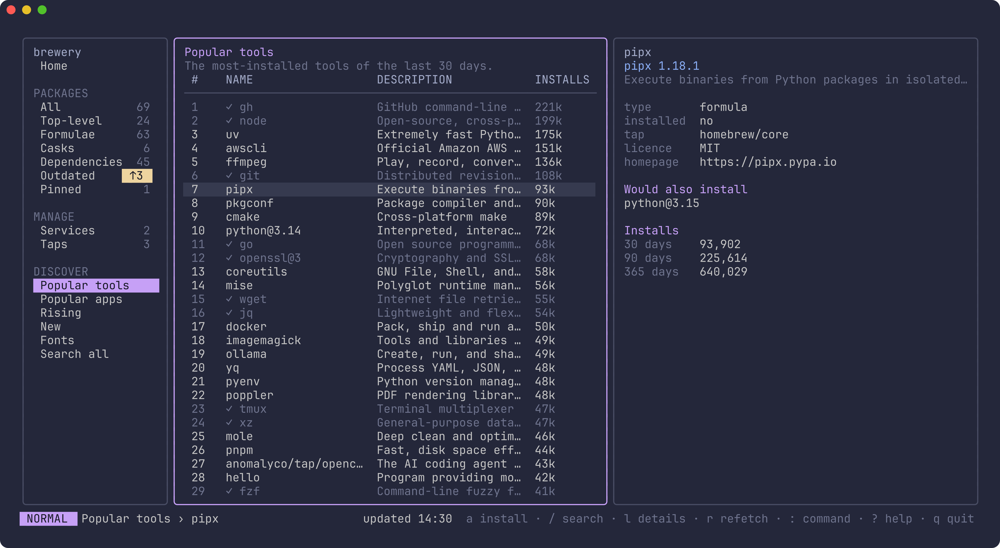
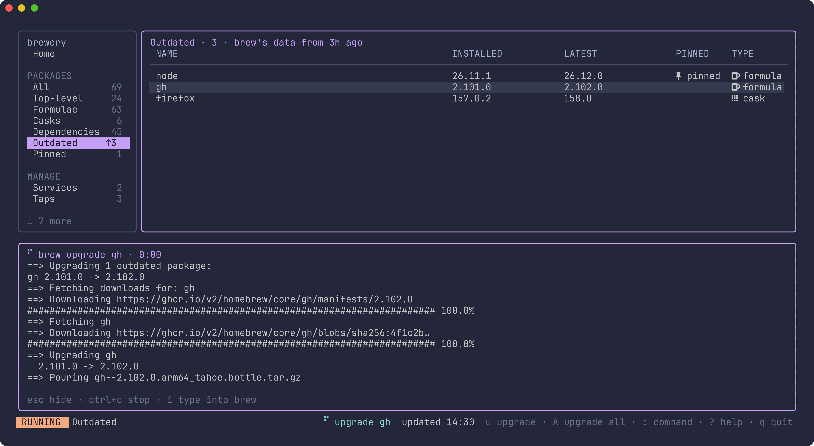

# brewery

A terminal dashboard for Homebrew. See what's installed, what's outdated and
what's running; upgrade, uninstall, pin, start and stop services, clean up,
and find new formulae, apps and fonts to install — with brew's own output
live in a drawer, and any brew command a `:` away.



## Install

```sh
brew install dillo/tap/brewery
```

Then run `brewery`.

## A look around

Everything installed, with what it needs and what needs it.



Find popular and rising packages, and install them.



brew's own output, live — answer its questions right in the drawer.



## Requirements

- macOS (Apple Silicon or Intel)
- Homebrew 7.0 or newer
- A [Nerd Font](https://www.nerdfonts.com) for icons — optional. Without one,
  run `brewery --no-icons`, or set `BREWERY_NO_ICONS` to any value.

## Sidebar

- **Home**: counts, doctor's warnings, recent jobs
- **Packages**: All, Top-level, Formulae, Casks, Dependencies, Outdated, Pinned,
  each with a preview of the selected package
- **Manage**: Services, with each service's log; Taps, where `x` untaps one
- **Discover**: Popular tools, Popular apps, Rising, New, Fonts, and Search all
  for the whole catalogue

## Keys

Press `?` anywhere for the keys that work there.

| Key | What it does |
|---|---|
| `h` `l` | move between the sidebar, the list and the preview |
| `1`–`4` | Home, Packages, Manage, Discover |
| `[` `]` | previous or next entry |
| `j` `k` on Home | move between its tiles; `enter` opens one |
| `j` `k`, `gg` `G`, `ctrl+d` `ctrl+u` | move in a list |
| `/` | filter the list |
| `u` | upgrade (Installed, Outdated) |
| `A` | upgrade all (Outdated) |
| `x` | uninstall (Installed), untap (Taps) |
| `p` | pin or unpin (Installed) |
| `space` | mark several for `u` or `x` |
| `s` `S` `R` | start, stop, restart a service; `L` follows its log |
| `a` | install (Discover) |
| `l` `tab` `enter` | preview, then `j` `k` scroll |
| `y` | copy the name |
| `gx` | open the homepage |
| `:` | run any brew command |
| `r` | refresh |
| `U` | `brew update` |
| `c` | clean up |
| `o` | show or hide brew's output |
| `i` | type into the running job (passwords, questions) |
| `ctrl+c` | stop the running job |
| `q` | quit |

## Files

- `$XDG_CACHE_HOME/brewery` (default `~/.cache/brewery`): the last snapshot
  of your packages, so brewery opens instantly, and Homebrew's analytics.
- `$XDG_STATE_HOME/brewery` (default `~/.local/state/brewery`): the history
  of jobs brewery ran, and crash logs.

## Building from source

```sh
make build   # ./brewery
make test
```

`make screenshots` regenerates the images above from a made-up machine
(`internal/ui/testdata/demo`). It needs Charm's
[freeze](https://github.com/charmbracelet/freeze)
(`go install github.com/charmbracelet/freeze@v0.2.2`) and the JetBrains Mono
Nerd Font (`brew install --cask font-jetbrains-mono-nerd-font`).

## Licence

MIT. See [LICENSE](LICENSE).
