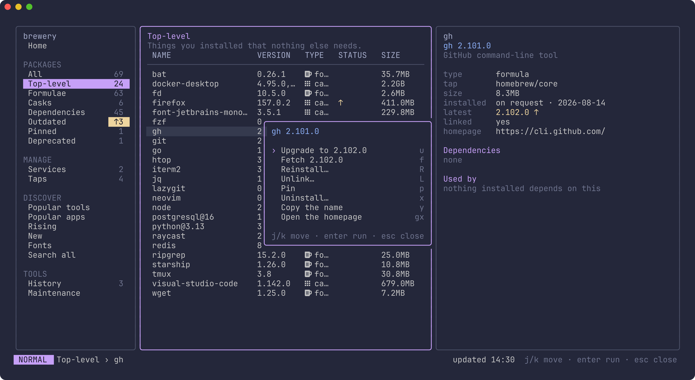
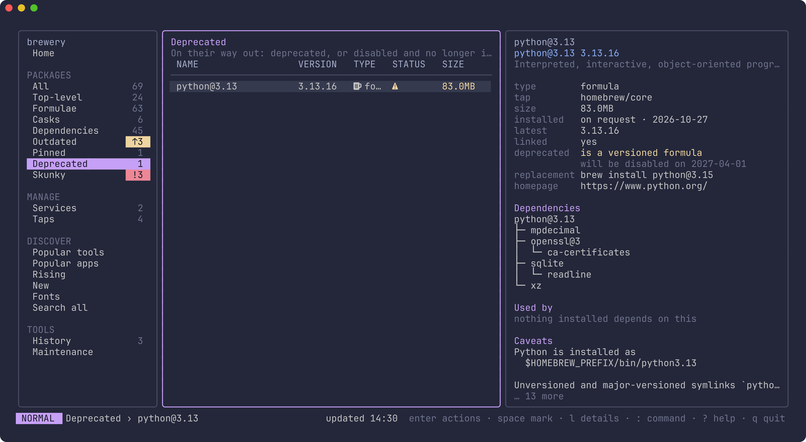
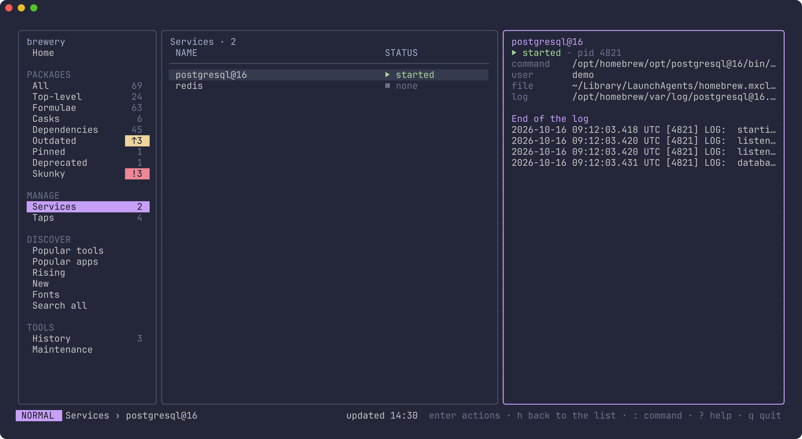
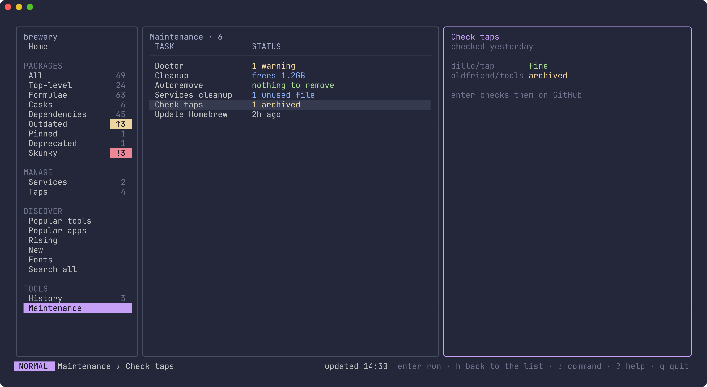
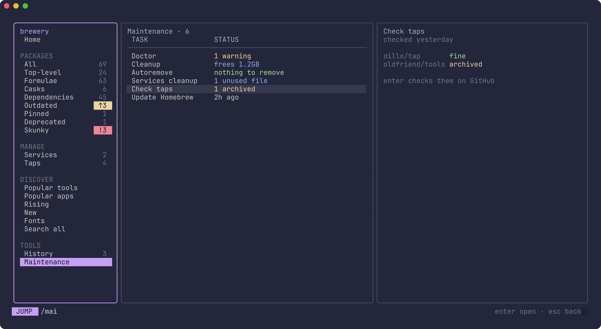

# brewery

A terminal dashboard for Homebrew. See what's installed, what's outdated and
what's running. Upgrade, uninstall, pin, reinstall and link packages, start
and stop services, keep Homebrew tidy, and find new formulae, apps and fonts
to install. brew's own output streams live in a drawer, and any brew command
is a `:` away.


## Install

brewery is a cask in the `dillo/tap` tap. Homebrew 7 only loads formulae and
casks from third-party taps that you have trusted, so there are three steps:
add the tap, trust brewery, then install it.

```sh
brew tap dillo/tap
brew trust --cask dillo/tap/brewery
brew install --cask dillo/tap/brewery
```

Then run `brewery`.

A few notes:

- **What gets trusted.** The second command trusts only the brewery cask,
  which is the narrowest choice. To trust everything in the tap instead, run
  `brew trust dillo/tap`. Without either, brew skips the tap and says it
  isn't trusted.
- **Gatekeeper.** brewery isn't signed by Apple. The cask clears the
  quarantine flag that macOS puts on downloads, so it runs without a
  warning.
- **Updating.** brewery shows up on its own Outdated list like any other
  package, so you can upgrade it from inside brewery, or run
  `brew upgrade --cask brewery`.
- **Removing it.** Run `brew uninstall --cask brewery`, then
  `brew untap dillo/tap` if you no longer want the tap.

### Requirements

- macOS on Apple Silicon. Intel Macs aren't supported.
- Homebrew 7.0 or newer. brewery checks when it starts, and asks you to
  run `brew update` if yours is older.
- A [Nerd Font](https://www.nerdfonts.com) for icons, which is optional.
  Without one, run `brewery --no-icons`, or set `BREWERY_NO_ICONS` to any
  value.

## Features

**Packages**

- Everything installed, in views: All, Top-level, Formulae, Casks,
  Dependencies, Outdated, Pinned, Deprecated and Skunky, each with a count in
  the sidebar.
- A details pane for the selected package: version, size on disk, how and
  when it was installed, whether it's pinned or linked, its homepage and
  caveats, and a tree of what it needs and what needs it.
- Upgrade one package, several marked ones, or everything. brewery warns
  before brew would refuse, for example when a package is pinned or a
  dependency is pinned behind it.
- Uninstall, with an offer to remove the dependencies nothing else needs.
- Pin and unpin, reinstall, link and unlink (including keg-only formulae),
  and fetch a newer version ahead of upgrading.
- Deprecated and disabled packages are marked in the list, and their details
  explain why in brew's own words, when they will be disabled, and what to
  install instead.
- Skunky lists installed formulae with known vulnerabilities, worst first,
  from `brew vulns` (OSV.dev). It scans at most once a day, or now with `r`
  on the view. The details list each finding and what fixes it. Casks, and
  formulae brew can't match to an upstream source, aren't scanned, so an
  empty list means nothing known was found, not that all is safe.

**An action menu**

- Press `enter` on any row to see what you can do with it, each action with
  its shortcut beside it. There's nothing to memorise: pick from the menu,
  and learn the keys as you go.

**Services**

- Every `brew services` service with its status, and its log in the details.
  Start, stop and restart them, or follow the log full screen.

**Discover**

- Homebrew's most installed tools and apps, what's rising, what's new, and
  fonts, from Homebrew's public install counts.
- Search the whole catalogue by name or description. Before you install, see
  what the package would add.

**Maintenance**

- Doctor's warnings, and how much a cleanup would free.
- Autoremove and services cleanup, each with a preview of what it would do.
- Check taps: asks GitHub whether each third-party tap's repository is
  archived, moved or gone. It only runs when you start it.
- `brew update`, with when it last ran.

**Running brew**

- brew's output streams live in a drawer. When brew asks a question or wants
  a password, you can answer it there.
- Jobs queue one after another, and wait when another brew holds
  its lock.
- History keeps every job brewery ran, with its full output. Run any of them
  again.
- Run any brew command with `:`, with completion for commands, flags and
  package names.

**Getting around**

- Vim-style keys throughout, `?` for the keys that work where you are, and
  `/` to filter any list or jump to a sidebar entry.
- Opens instantly from a cached snapshot, then refreshes in the background.
- From 122 columns the sidebar, list and details sit side by side. In a
  narrower window the columns slide with the focus.

## A look around

Everything installed, with what it needs and what needs it.


Press `enter` on a row for everything you can do with it.



Packages on their way out, with brew's reason and what to install instead.



Services, with the end of each one's log.



Maintenance in one place, including a check of your taps on GitHub.



Find popular and rising packages, and install them.


brew's own output, live. Answer its questions right in the drawer.


Type `/` in the sidebar to jump to an entry.



## Sidebar

- **Home**: counts, doctor's warnings and recent jobs
- **Packages**: All, Top-level, Formulae, Casks, Dependencies, Outdated,
  Pinned, Deprecated and Skunky
- **Manage**: Services, with each service's log, and Taps, with what Check
  taps found
- **Discover**: Popular tools, Popular apps, Rising, New, Fonts, and Search
  all for the whole catalogue
- **Tools**: History, the jobs brewery has run, and Maintenance

## Keys

Press `?` anywhere for the keys that work there, and `enter` on a row for
its actions.

**Everywhere**

| Key | What it does |
|---|---|
| `h` `l` | move between the sidebar, the list and the details |
| `1`–`5` | Home, Packages, Manage, Discover, Tools |
| `[` `]` | previous or next sidebar entry |
| `:` | run any brew command; `:jobs` opens History |
| `r` | refresh |
| `U` | `brew update` |
| `c` | clean up |
| `o` | show or hide brew's output |
| `i` | type into the running job (passwords, questions) |
| `ctrl+c` | stop the running job |
| `?` | the keys that work here |
| `q` | quit |

**Sidebar**

| Key | What it does |
|---|---|
| `j` `k`, `gg` `G` | choose an entry |
| `/` | jump to an entry by name |
| `l` `enter` | go to its list |

**Lists**

| Key | What it does |
|---|---|
| `j` `k`, `gg` `G`, `ctrl+d` `ctrl+u` | move |
| `enter` | the action menu for the row |
| `l` `tab` | the details, then `j` `k` scroll them |
| `/` | filter the list; `esc` clears it |
| `y` | copy the name (on History, the command) |
| `gx` | open the homepage |
| `space` | mark several (Installed and Outdated) |

**Shortcuts for actions**, all also in the action menu:

| Where | Key | What it does |
|---|---|---|
| Installed | `u` | upgrade |
| | `x` | uninstall |
| | `p` | pin or unpin |
| | `R` | reinstall |
| | `L` | link or unlink |
| | `f` | fetch the newer version |
| Outdated | `u` | upgrade |
| | `f` | fetch the newer version |
| | `A` | upgrade all |
| Services | `s` `S` `R` | start, stop, restart |
| | `L` | follow the log full screen |
| Taps | `x` | untap |
| Discover | `a` | install |
| | `r` | fetch the install counts again |
| History | `R` | run the job again |
| Maintenance | `enter` | run the selected task |

**Home**

| Key | What it does |
|---|---|
| `h` `l` | along the tiles, and from Doctor to Recent jobs; `h` from the first tile goes back to the sidebar |
| `j` `k` | down from the tiles to Doctor (then scroll it), and back up |
| `enter` | open a tile, or History from Recent jobs |

## Files

- `$XDG_CACHE_HOME/brewery` (default `~/.cache/brewery`): the last snapshot
  of your packages, so brewery opens instantly, Homebrew's install counts,
  and what Check taps last found.
- `$XDG_STATE_HOME/brewery` (default `~/.local/state/brewery`): the history
  of jobs brewery ran, and crash logs.

## Building from source

```sh
make build   # ./brewery
make test
```

`make screenshots` regenerates the images above from a made-up machine
(`internal/ui/testdata/demo`). It needs Charm's
[freeze](https://github.com/charmbracelet/freeze)
(`go install github.com/charmbracelet/freeze@v0.2.2`) and the JetBrains Mono
Nerd Font (`brew install --cask font-jetbrains-mono-nerd-font`).

## Licence

MIT. See [LICENSE](LICENSE).
